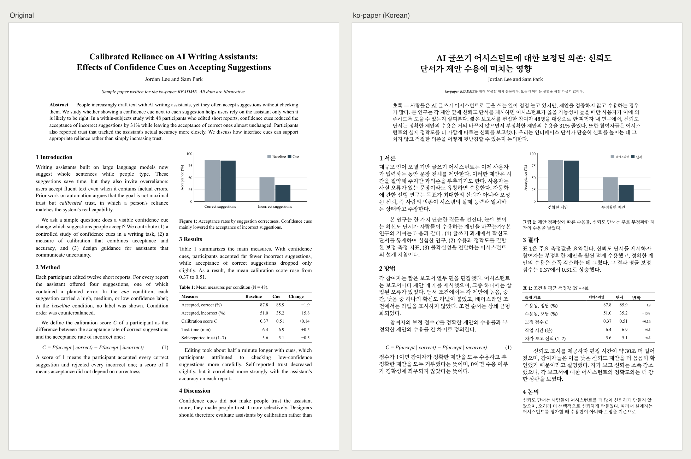
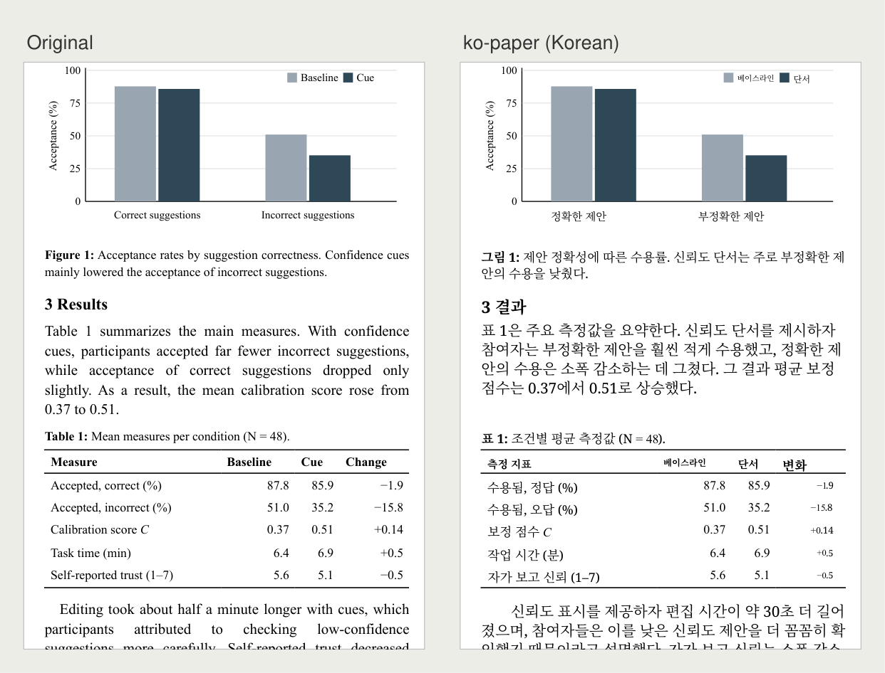
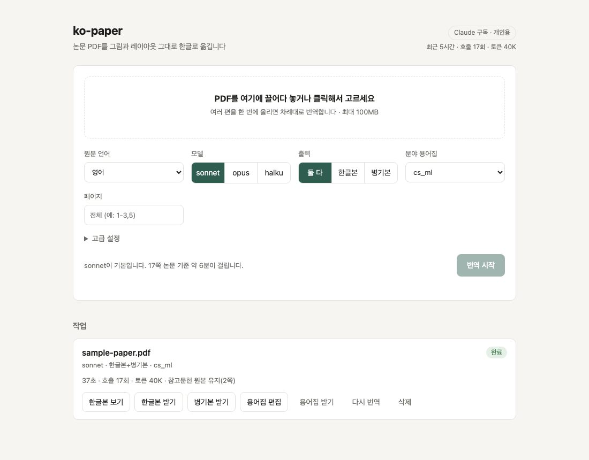

# ko-paper

논문 PDF(기본 영어, 독일어·프랑스어·일본어 등 10개 언어)를 그림·표·수식 위치를 유지한 채 한글 PDF로 번역한다.
레이아웃 처리는 [BabelDOC](https://github.com/funstory-ai/BabelDOC), 번역은 Claude(또는 Codex)가 맡는다.
Claude Code나 Codex에 스킬로 설치하면 "이 논문 번역해줘" 한마디로 쓸 수 있다.



<sub>예시는 이 README를 위해 직접 쓴 샘플 논문이다([HTML](docs/sample/sample-paper.html) ·
[원문 PDF](docs/sample/sample-paper.pdf) · [한글본](docs/sample/sample-paper.ko.pdf) ·
[병기본](docs/sample/sample-paper.ko.dual.pdf)). 2쪽, Claude Sonnet, 약 40초.</sub>

> **각자 자기 컴퓨터에서, 자기 계정으로 쓰는 도구다.** 기본 백엔드는 로컬에 로그인된
> Claude Code(`claude -p`), 또는 Codex(`codex exec`)라서 번역에 쓰는 사용량은 실행한 사람의
> 구독에서 나간다. 이 백엔드로 서버를 띄워 다른 사람에게 번역을 제공하면 안 된다. 그런 용도라면
> `KOPAPER_BACKEND=anthropic-api`(API 키, 종량제)를 쓴다. 웹 UI도 항상 127.0.0.1에만 열린다.

## 사용 예시

**그림·표·수식은 그 자리에 그대로 둔다.** 그림 안의 범례와 항목 이름, 표의 머리글과 셀까지 번역하고,
수식과 숫자는 건드리지 않는다. 세로로 회전된 축 이름처럼 일부 글자는 원문으로 남을 수 있다.



**웹 UI** — PDF를 끌어다 놓고 원문 언어·모델·출력 형식을 고르면 된다. 완료된 작업에서 한글본을
바로 열거나, 용어집을 고쳐 바뀐 문단만 다시 번역할 수 있다.



## 스킬로 설치 (권장)

준비물: [Claude Code](https://claude.com/claude-code) 또는 [Codex](https://github.com/openai/codex) 로그인,
[uv](https://docs.astral.sh/uv/), git. BabelDOC과 Python 의존성은 처음 실행할 때 자동으로 설치된다.
번역 백엔드는 `claude`가 있으면 Claude Code, 없고 `codex`만 있으면 Codex로 자동으로 고른다.

**에이전트에게 맡기기** — 아래 글을 Claude Code나 Codex에 그대로 붙여 넣으면 묻지 않고 끝까지 설치한다.

```text
ko-paper(https://github.com/maenjh/ko-paper)를 이 컴퓨터에 설치해 줘. 나에게 질문하지 말고 끝까지 진행해.
1. 운영체제를 직접 확인해(uname 또는 $env:OS). 사용자에게 묻지 않는다.
2. macOS·Linux·WSL이면 실행:
   curl -fsSL https://raw.githubusercontent.com/maenjh/ko-paper/main/install.sh | bash
   Windows PowerShell이면 실행:
   irm https://raw.githubusercontent.com/maenjh/ko-paper/main/install.ps1 | iex
3. 네트워크나 샌드박스 때문에 막히면 권한 상승을 요청해 같은 명령을 다시 실행해.
4. 출력 끝에 "kopaper ready"가 나오면 성공. 실패 줄(✗ 또는 [x])이 있으면 그 안내대로 직접 고치고
   ko-paper doctor 로 다시 확인해. 로그인처럼 내가 브라우저에서 해야 하는 일만 마지막에 한 줄로 알려 줘.
5. 끝나면 설치된 위치와 "에이전트를 다시 시작하면 '이 논문 번역해줘'로 쓸 수 있다"만 짧게 알려 줘.
```

**플러그인으로** (Claude Code)

```text
/plugin marketplace add maenjh/ko-paper
/plugin install ko-paper@ko-paper
```

**스크립트로** (`~/.ko-paper/src`에 받고, 찾은 에이전트마다 스킬을 복사)

```bash
curl -fsSL https://raw.githubusercontent.com/maenjh/ko-paper/main/install.sh | bash
# 한쪽에만:  ... | bash -s -- --claude   또는   ... | bash -s -- --codex
```

**Windows** (PowerShell, WSL 없이)

```powershell
irm https://raw.githubusercontent.com/maenjh/ko-paper/main/install.ps1 | iex
# Claude Code도 설치:  $env:KOPAPER_WITH="claude-code"; irm .../install.ps1 | iex
# Codex도 설치:        $env:KOPAPER_WITH="codex"; irm .../install.ps1 | iex   (Node.js 필요)
# 한쪽에만:            $env:KOPAPER_AGENTS="claude"  또는  "codex"
```

git이 필요하다(`winget install --id Git.Git -e`). Windows의 Claude Code는 Git Bash로 명령을 실행하므로
스킬은 `kopaper.sh`를, Codex·PowerShell에서는 `kopaper.ps1`을 쓴다.

`ko-paper update`(또는 설치 명령을 다시 실행)로 최신 버전을 받는다. 처음 설치한 에이전트에만 다시 설치한다.

## ChatGPT·Claude 앱만 쓴다면

터미널 도구 없이 ChatGPT나 Claude **채팅 앱**만 쓰는 사람도 설치할 수 있다. 채팅 앱은 내 컴퓨터에서
명령을 직접 실행하지 못하므로, 앱이 터미널에 붙여 넣을 명령을 하나씩 알려 주고 결과를 보고
다음 단계를 안내하는 방식이다. 문구에 "묻지 말라"를 넣어 두어, 앱이 첫 답변에서 바로 설치 명령을 준다. 번역은 내 Claude 또는 ChatGPT 구독으로 돌아간다(Claude 구독은
Claude Code로, ChatGPT 구독은 Codex CLI로 로그인해서 쓴다).

아래 글을 그대로 복사해 ChatGPT나 Claude 앱에 붙여 넣는다.

```text
내 컴퓨터에 ko-paper(https://github.com/maenjh/ko-paper)를 설치하려고 해.
영어 등 외국어 논문 PDF를 레이아웃 그대로 한글 PDF로 번역해 주는 무료 오픈소스 도구야.
너는 명령을 직접 실행할 수 없으니 내가 붙여 넣을 명령을 알려 줘. 나에게 질문하지 말고 아래대로
첫 답변에서 바로 설치 명령을 줘.

1. 구독은 묻지 마. 네가 ChatGPT면 내 구독은 ChatGPT(Codex 사용), 네가 Claude면 Claude 구독
   (Claude Code 사용)으로 정해.
2. 운영체제도 묻지 마. 아래에서 네 구독에 맞는 두 줄(macOS·Linux용, Windows용)을 함께 보여 주고
   "Mac은 터미널(Spotlight에서 '터미널'), Windows는 시작 메뉴의 PowerShell에 붙여 넣으라"고 알려 줘.
   - Claude 구독, macOS·Linux:
     curl -fsSL https://raw.githubusercontent.com/maenjh/ko-paper/main/install.sh | bash -s -- --with-claude-code
   - Claude 구독, Windows:
     $env:KOPAPER_WITH="claude-code"; irm https://raw.githubusercontent.com/maenjh/ko-paper/main/install.ps1 | iex
   - ChatGPT 구독, macOS·Linux:
     curl -fsSL https://raw.githubusercontent.com/maenjh/ko-paper/main/install.sh | bash -s -- --with-codex
   - ChatGPT 구독, Windows (Node.js 필요: winget install --id OpenJS.NodeJS.LTS -e):
     $env:KOPAPER_WITH="codex"; irm https://raw.githubusercontent.com/maenjh/ko-paper/main/install.ps1 | iex
   Windows에서 git이 없다는 오류가 나면 winget install --id Git.Git -e 후 PowerShell을 새로 열고 다시 실행.
3. 같은 답변에서 다음 단계도 미리 알려 줘: 출력에 "not logged in"이 있으면 로그인
   (Claude: claude auth login, ChatGPT: codex login, 브라우저에서 내 계정으로 로그인) 후
   창을 새로 열고 ko-paper doctor. "kopaper ready"가 나오면 ko-paper 를 실행하면 브라우저에
   번역 화면이 열리고, 거기에 PDF를 끌어다 놓으면 된다.
4. 내가 오류 출력을 붙여 넣으면 원인과 해결 명령만 짧게 알려 줘. 비밀번호나 API 키는 묻지 마.
```

설치가 끝나면 앱 없이도 쓸 수 있다.

```bash
ko-paper                                   # 웹 UI를 브라우저로 연다
ko-paper translate ~/Downloads/paper.pdf   # 터미널에서 바로 번역
```

**Claude 데스크톱 앱의 Code 탭**은 Claude Code와 같아서, 위 "에이전트에게 맡기기"처럼 말하면 알아서
설치한다. claude.ai·ChatGPT의 웹 채팅이 자체 샌드박스에서 PDF를 직접 번역하는 것은 지원하지 않는다
(BabelDOC과 내 구독 로그인이 내 컴퓨터에 있어야 한다).

설치 후 Claude Code에서 PDF 경로와 함께 요청하면 된다.

```text
~/Downloads/attention.pdf 이 논문 번역해줘
1~3쪽만 한글본으로 뽑아줘
~/Downloads/aufsatz.pdf 독일어 논문인데 한글로 번역해줘
```

결과는 입력 파일 옆에 `<이름>.ko.pdf`(한글본)와 `<이름>.ko.dual.pdf`(원문 병기본)로 생긴다.
스킬로 실행할 때 캐시·용어집·작업 로그는 `~/.ko-paper/data`에 쌓인다.

## Windows Smart App Control

Windows 11의 **Smart App Control**(SAC)은 서명이 없고 평판이 쌓이지 않은 프로그램 파일을 불러오는 순간
막는다. ko-paper와 BabelDOC은 PyMuPDF·onnxruntime·OpenCV 같은 컴파일된 Python 모듈(`.pyd`, `.dll`)을
쓰는데, 이 파일들은 대부분 서명이 없다. 그래서 SAC가 켜진 PC에서는 번역 중에 이런 오류가 날 수 있다.

```text
ImportError: DLL load failed while importing _mupdf: 애플리케이션 제어 정책에서 이 파일을 차단했습니다.
```

ko-paper가 줄이려고 하는 것:

- `ko-paper doctor`가 컴파일된 모듈을 실제로 불러와 본다. 막히면 `kopaper ready` 대신 차단 사실을 알린다.
- Python 3.12로 고정한다. 가장 널리 쓰이는 빌드라 SAC의 평판 판정을 받을 가능성이 가장 높다.
- 설치마다 새로 생기는 `kopaper.exe` 대신 `python -m kopaper`로 실행한다.

그래도 막히면 보안 기능인 **SAC를 끄지 말고** 아래 둘 중 하나를 쓴다.

**간이 모드 (설치 없음)** — Claude Code나 Codex에서 스킬로 번역을 요청하면, doctor가 차단을 감지했을 때
에이전트가 BabelDOC 없이 직접 번역한다. 원문 구조(제목·문단·표·캡션·수식)를 살린 한글 PDF
(`<이름>.ko.lite.pdf`)를 Edge로 만든다. 원문 레이아웃(2단, 페이지 위치)과 그림 이미지는 유지하지 않는다.
"간단히 번역해줘", "설치 없이 번역해줘"라고 하면 다른 OS에서도 간이 모드로 번역한다.

**WSL (레이아웃 유지)** — 원문 레이아웃이 필요하면 WSL 안에서 쓴다. WSL의 Linux 프로그램에는
SAC가 적용되지 않는다.

```powershell
wsl --install          # 관리자 PowerShell, 끝나면 재부팅
```

재부팅 후 시작 메뉴의 **Ubuntu**에서 macOS·Linux용 설치 명령을 실행한다.

```bash
curl -fsSL https://raw.githubusercontent.com/maenjh/ko-paper/main/install.sh | bash -s -- --with-codex   # Claude면 --with-claude-code
ko-paper        # Windows 브라우저에서 http://127.0.0.1:8787 이 열리지 않으면 직접 연다
ko-paper translate /mnt/c/Users/<이름>/Downloads/paper.pdf
```

## 직접 설치 (CLI·웹 UI)

- Claude Code 로그인 (`claude` 실행 후 `/login`)
- BabelDOC: `uv tool install --python 3.12 "babeldoc==0.5.24" --with "bitstring<5"` (레이아웃 보정이 이 버전에 맞춰져 있다)
- 이 저장소: `uv sync` (API 백엔드도 쓰려면 `uv sync --extra api`)

## 웹 UI

```bash
.venv/bin/kopaper serve --open    # http://127.0.0.1:8787/ 을 브라우저로 연다
```

- PDF를 끌어다 놓으면 대기열에 들어가고 한 편씩 차례대로 번역한다.
- 원문 언어(영어, 독일어, 프랑스어 등)를 고를 수 있다. 출력은 항상 한국어다.
- 단계 이름, 진행률, 경과 시간, 남은 시간 추정이 실시간으로 표시된다.
- 완료되면 한글본 보기, 한글본·병기본·용어집 받기가 가능하다. 진행 중 취소, 완료 후 삭제, 다시 번역도 된다.
- **용어집 편집**: 완료된 작업에서 이 논문의 용어집을 열어 고치고 "저장 후 다시 번역"을 누르면, 바뀐 용어가 들어간 문단만 다시 번역된다.
- 머리글에 최근 5시간 동안 ko-paper가 보낸 Claude 호출 수와 토큰이 보인다. 한도에 걸리면 경고가 뜨고 자동으로 재시도한다. 구독의 남은 한도 자체는 Claude가 공개하지 않아 표시할 수 없다.
- 서버는 항상 127.0.0.1에만 열린다. 외부에 노출하지 않는다. 브라우저에서 다른 사이트가 이 서버를 호출하는 것도 막는다(Host·Origin 검사).
- 작업 기록은 `data/web_jobs.sqlite`, 파일은 `data/web/<작업 ID>/`에 남는다. 서버를 재시작하면 진행 중이던 작업은 실패로 표시된다.

## CLI

```bash
.venv/bin/kopaper translate paper.pdf                # paper.ko.pdf + paper.ko.dual.pdf (입력 옆에 생성)
.venv/bin/kopaper translate a.pdf b.pdf -o out/      # 여러 편, 출력 폴더 지정
.venv/bin/kopaper translate paper.pdf -p 1-3 --mono-only
.venv/bin/kopaper translate paper.pdf -m opus        # 모델 변경 (sonnet 기본)
.venv/bin/kopaper translate aufsatz.pdf -l de        # 독일어 논문 (원문 언어, 기본 en)
.venv/bin/kopaper translate paper.pdf -g my_terms.csv  # 내 용어집 (최우선)
.venv/bin/kopaper serve --proxy-only                 # 프록시만 실행 (127.0.0.1:8787)
```

프록시가 떠 있지 않으면 `translate`가 자동으로 띄운다.

## 용어집

CSV 형식은 `source,target,tgt_lng`이다. 충돌 시 우선순위는 다음과 같다.

1. `-g`로 넘긴 사용자 용어집
2. 웹에서 고친 논문별 용어집 `data/glossaries/<paper_id>.user.csv` (있으면 자동 추출 용어집 대신 쓴다)
3. 분야 용어집 `glossary/<domain>.csv` (`-d`로 선택, 기본 `cs_ml`)
4. 논문별 자동 추출 용어집 `data/glossaries/<paper_id>.csv`

자동 추출 시 학회·기관·출판사 이름처럼 원문 그대로 둬야 할 고유명사는 걸러 낸다.

논문을 처음 전체 번역할 때 BabelDOC이 용어를 자동 추출해 저장한다. 같은 파일을 다시 번역하면 이 용어집을 재사용하고 추출 단계를 건너뛴다. 용어가 실행마다 바뀌지 않고, 토큰도 약 30% 줄어든다. 일부 페이지만 번역한 실행의 용어는 저장하지 않는다.

## 레이아웃 보정

BabelDOC 위에 다음 보정을 더한다. 모두 `src/kopaper/babeldoc_launcher.py`와 `il_fixes.py`, `postprocess.py`에 있다.

- **수식 폰트**: Cambria Math를 수식으로 취급해 깨진 변수 기호를 원래 모양으로 둔다.
- **참고문헌**: 영문 원본에서 참고문헌 영역을 찾아 Claude에 보내지 않고, 결과 PDF에서는 원본으로 되돌린다.
- **표 셀**: 여러 줄짜리 셀을 한 문단으로 합쳐 번역하고, 셀 안에서만 줄바꿈해 아래 행과 겹치지 않게 한다.
- **알려진 한계**: 작은 대문자(small caps) 제목은 글자 일부가 원문으로 남거나 깨질 수 있다.
  간격이 좁은 저자 줄과 소속 줄은 한 문단으로 합쳐질 수 있다. 둘 다 BabelDOC의 문단 인식 단계에서 생긴다.
- **스캔본**: 텍스트 레이어가 없는 PDF는 번역 전에 멈추고 알려 준다. `--ocr`(웹은 고급 설정)로 Tesseract OCR 후 번역할 수 있지만 품질이 낮은 실험 기능이다.

## 백엔드

| 백엔드 | 쓰는 계정 | 비고 |
|---|---|---|
| `claude-code` (기본) | Claude Code 로그인 (Claude 구독) | 호출당 오버헤드 약 0.9k 토큰 |
| `codex` | Codex 로그인 (ChatGPT 요금제) | 호출당 오버헤드 약 9k 토큰. 샘플 2쪽 기준 Claude보다 약 2배 느리다 |
| `anthropic-api` | `ANTHROPIC_API_KEY` (종량제) | `uv sync --extra api`. 남에게 서비스할 때는 이것만 쓴다 |

모델 선택(sonnet/opus/haiku)은 `codex` 백엔드에서 추론 강도로 바뀐다(haiku·sonnet → low, opus → medium).

## 환경 변수

| 변수 | 기본값 | 설명 |
|---|---|---|
| `KOPAPER_BACKEND` | `claude-code` | `claude-code`, `codex`, `anthropic-api` (스킬은 설치된 CLI로 자동 선택) |
| `KOPAPER_CODEX_MODEL` | Codex 기본 모델 | `codex` 백엔드의 모델 |
| `KOPAPER_CODEX_EFFORT` | `low` (opus 선택 시 `medium`) | `codex` 백엔드의 추론 강도 |
| `KOPAPER_PORT` | `8787` | 프록시 포트 |
| `KOPAPER_MAX_CONCURRENCY` | `4` | 동시 Claude 호출 수 |
| `KOPAPER_EFFORT` | `medium` | API 백엔드의 effort |
| `KOPAPER_EXTRA_MATH_FONTS` | Cambria Math | 수식으로 취급할 폰트 이름 정규식 |
| `KOPAPER_DATA` | `./data` (스킬은 `~/.ko-paper/data`) | 작업·캐시·로그 위치 |
| `KOPAPER_MERGE_TABLE_CELLS` | `1` | `0`이면 표 셀 병합을 끈다 |
| `KOPAPER_TABLE_LINE_SKIP` | `1.15` | 표 셀 안 줄 간격 |

## 구조

```
웹 UI / kopaper translate ─► 작업 큐 ─► BabelDOC (babeldoc_launcher.py로 수식 폰트 보정)
                        │ OpenAI 형식 요청
                        ▼
                 kopaper proxy (FastAPI, SQLite 캐시, 사용량 로그)
                        │
              ┌─────────┴─────────┐
        claude -p (구독)     Anthropic API (claude-opus-5-5 / claude-sonnet-5-5)
```

작업마다 `data/jobs/<paper_id>/<시각>/`에 명령, 로그, 결과 요약이 남는다.

## 라이선스

[AGPL-3.0-or-later](LICENSE). ko-paper는 AGPL-3.0인 BabelDOC의 내부 모듈을 불러와 패치해 쓰므로
같은 라이선스를 따른다. 수정한 버전을 배포하거나 네트워크 서비스로 제공하면 소스도 공개해야 한다.

번역 대상 논문의 저작권은 원저자와 출판사에 있다. 번역본은 개인 학습용으로 쓰고,
재배포하기 전에 원문의 라이선스를 확인한다.
