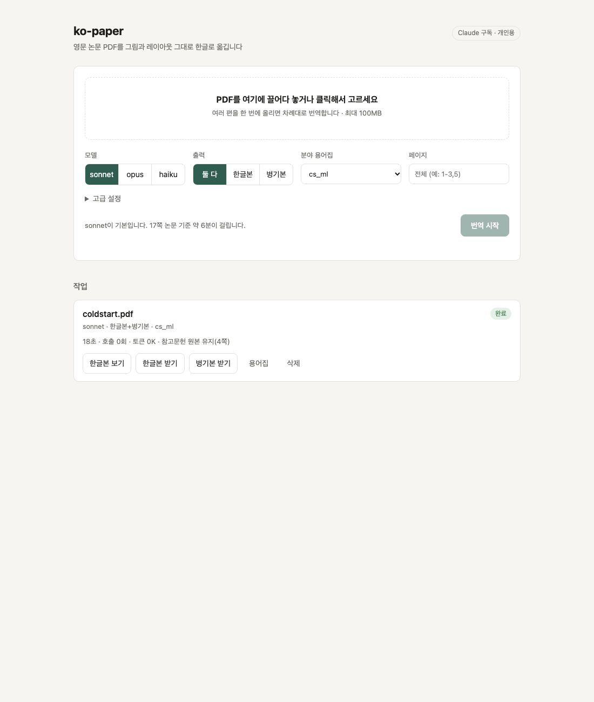
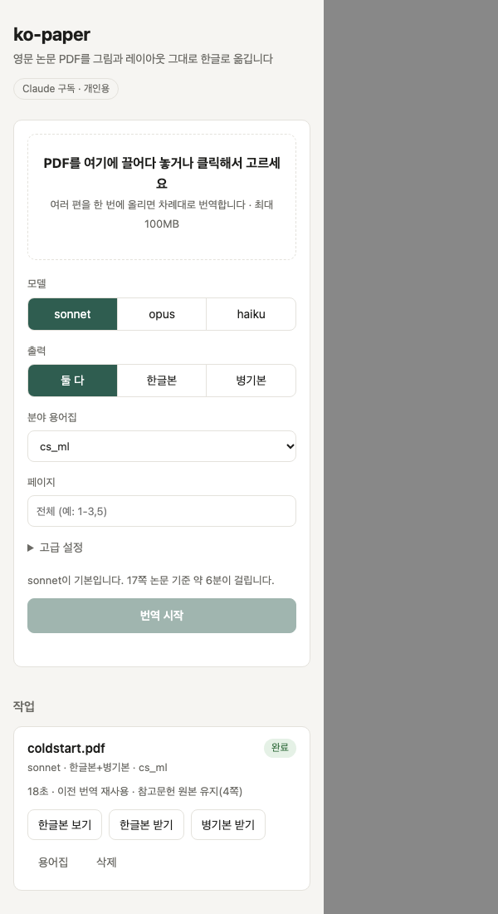

# Phase 2 보고서: 웹 UI

일자: 2026-10-06

## 1. 구현

| 파일 | 내용 |
|---|---|
| `src/kopaper/web/app.py` | 웹 페이지와 JSON API. 프록시(`/v1/*`)와 같은 서버에서 동작 |
| `src/kopaper/web/jobs.py` | SQLite 작업 큐, 단일 작업자 스레드, 취소, 삭제, 재시작 복구 |
| `src/kopaper/web/static/index.html` | 단일 페이지 UI. 외부 라이브러리 없음, 다크 모드 지원 |
| `src/kopaper/pipeline.py` | pty로 BabelDOC을 실행해 실시간 진행률 파싱, 취소 지원 |
| `tests/test_web.py` | 업로드·실행·다운로드·삭제, 입력 검증, 취소·실패 테스트 |

API:

| 메서드 | 경로 | 설명 |
|---|---|---|
| GET | `/api/options` | 백엔드, 모델, 분야 용어집 목록 |
| GET / POST | `/api/jobs` | 작업 목록 / PDF 업로드로 작업 생성 |
| GET | `/api/jobs/{id}` | 작업 상태와 진행률 |
| POST | `/api/jobs/{id}/cancel` | 대기 또는 진행 중 작업 취소 |
| DELETE | `/api/jobs/{id}` | 작업과 파일 삭제 |
| GET | `/api/jobs/{id}/files/{mono\|dual\|glossary}` | 결과 다운로드, `?inline=1`이면 브라우저에서 열기 |

## 2. 설계 결정

- **진행률**: BabelDOC 출력을 파일로 보내면 진행 막대가 최종 상태만 남는다. 가상 터미널(pty)로 실행하면 BabelDOC이 전체 진행률과 현재 단계를 실시간으로 낸다. 이 값을 파싱해 단계 이름을 한글로 바꿔 보여 준다.
- **한 번에 한 편**: 구독 한도를 고려해 작업은 순서대로 하나씩 처리한다. 한 작업 안에서는 Claude 호출을 4개까지 병렬로 보낸다.
- **입력 검증**: PDF 시그니처, 100MB 상한, 모델·출력·용어집 이름 화이트리스트, 페이지 형식을 검사한다. 업로드 파일명에서 경로 성분을 제거한다.
- **로컬 전용**: 서버는 127.0.0.1에만 바인딩한다. 인증은 없다.

## 3. 검증

| 항목 | 결과 |
|---|---|
| 단위·API 테스트 | 8개 통과 |
| 실제 업로드 → 번역 → 다운로드 | 4쪽 논문 성공. 진행률 0% → 25% → 90% → 96% → 완료 |
| 결과 파일 | 한글본 541KB, 병기본 776KB, 용어집 CSV 모두 200 응답 |
| 진행 중 취소 | 상태가 취소됨으로 바뀌고 BabelDOC 프로세스도 종료 |
| 화면 (1100px, 390px) | 헤드리스 Chrome으로 확인. 390px에서 옵션이 한 줄씩 쌓이고 넘침 없음 |

## 4. 발견해 고친 문제

- 결과 폴더가 없으면 복사가 실패했다. CLI는 항상 기존 폴더를 써서 드러나지 않았다. 파이프라인이 폴더를 만들도록 고쳤다.
- 같은 논문을 다시 번역해 BabelDOC 캐시만 쓴 경우 "토큰 0K"로 표시됐다. "이전 번역 재사용"으로 바꿨다.
- 한글 문장이 글자 단위로 줄바꿈되어 "요"가 혼자 다음 줄로 넘어갔다. 단어 단위 줄바꿈으로 바꿨다.

## 5. 확인하지 못한 것

- 앱 내장 브라우저 창에서 로컬 주소 접근이 거부되어, 화면 확인은 헤드리스 Chrome 스크린샷으로 대신했다. 드래그 앤 드롭과 클릭 같은 실제 조작은 사람이 직접 확인해야 한다.
- 웹 경유 실제 번역은 BabelDOC 캐시가 있는 논문으로만 돌렸다. 새 논문의 "번역" 단계 진행률 표시는 CLI 실행 결과로 간접 확인했다.

## 6. Phase 3 후보

- 표 행 겹침 보정, 참고문헌을 번역 요청에서 아예 제외
- 용어집 편집 화면 (논문별 용어 수정 후 재번역)
- 구독 한도 사용량 표시
- 스캔 PDF OCR

## 7. 화면

