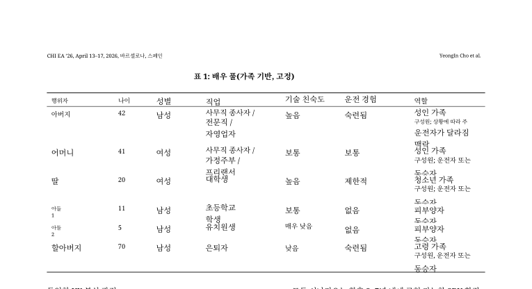
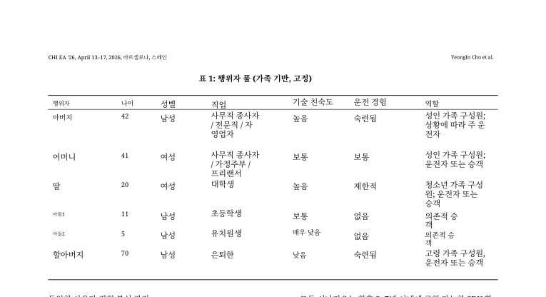
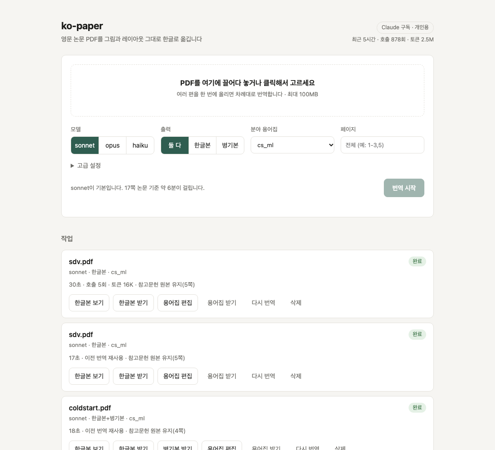

# Phase 3 보고서: 품질과 효율

일자: 2026-10-06

## 1. 결과 요약

| 과제 | 결과 |
|---|---|
| 참고문헌을 번역 요청에서 제외 | 완료. 17쪽 논문의 참고문헌 4쪽이 호출 2회(결론 문단)로 줄어듦. 이 논문에서 약 10만 토큰 절약 |
| 표 행 겹침 | 완료. 여러 줄 셀을 한 문단으로 합쳐 번역. 겹침 해소, 셀 번역도 문장 단위로 자연스러워짐 |
| 용어집 편집 후 재번역 (웹) | 완료. 용어 1개 수정 후 재번역이 호출 5회, 30초. 해당 용어 5곳 모두 반영 |
| 사용량 표시 | 완료. 최근 5시간·7일 호출, 토큰, 한도 오류. 구독 잔여 한도는 Claude가 공개하지 않아 표시 불가 |
| 스캔 PDF | 부분 완료. 감지는 정확. OCR 번역은 품질이 낮아 기본 꺼짐(실험 기능) |
| 2차 검토 패스 | 완료(옵션). 토큰 약 2배, 개선 폭은 작음 |
| 자동 용어집 고유명사 필터 | 완료. 학회·기관·출판사 이름 제외 |

테스트 14개 통과.

## 2. 참고문헌 제외

- 번역 전에 영문 원본에서 참고문헌 영역(페이지, 단별 사각형)을 계산해 BabelDOC 실행기에 넘긴다.
- 실행기는 용어 추출과 번역 직전에 그 영역 안의 문단 텍스트를 비운다. BabelDOC은 텍스트가 빈 문단을 건너뛴다.
- 결과 PDF에서는 기존 후처리가 그 영역을 원본으로 되돌린다.

| 논문 | 건너뛴 문단 | 복원 페이지 |
|---|---|---|
| CHI 17쪽 | 16 | 14~17 |
| Cold-start 4쪽 | 6 | 4 |
| SDV 8쪽 | 2 | 5 |

## 3. 표 행 겹침

원인 분석 과정이 길었다.

1. 처음에는 한글 조판 줄 간격(1.5배)과 상자 확장이 원인이라 보고 표 셀만 줄 간격 1.15배, 확장 금지로 바꿨다. 효과가 없었다.
2. 실제 원인은 BabelDOC이 표 셀의 각 줄을 별개 문단으로 잡는 것이었다. "Adult family / member; driver or / passenger"가 줄마다 따로 번역되고 따로 배치되어, 한글로 바뀌며 아래 행과 겹쳤다. 표 셀 문단에는 "table" 라벨도 붙지 않아(일반 "fallback_line"), 레이아웃 모델이 찾은 표 영역 안에 있는지로 판정했다.
3. 같은 행, 같은 열의 줄을 한 문단으로 합친다. 행 시작은 "열의 절반 이상에서 동시에 줄이 시작되는 높이"로 정한다. 처음에는 맨 왼쪽 열 기준, 이어서 BabelDOC 문단 상자 기준으로 했으나 둘 다 행이 어긋났다. 문단을 이루는 실제 글자 위치를 쓰자 정확해졌다.

결과: SDV 표 1의 모든 행이 제자리에 있고, 셀 내용이 한 문장으로 번역되어 셀 안에서 줄바꿈된다. 한 줄짜리 셀로 된 숫자 표(Cold-start 표 I, II)와 SDV 표 2, 3은 영향 없음을 확인했다.

남은 사소한 문제: 일부 짧은 행 이름이 작게 조판되고, 좁은 셀에서 한글 단어가 중간에 줄바꿈된다.

## 4. 용어집 편집

- 웹에서 완료된 작업의 "용어집 편집"을 누르면 이 논문의 용어 목록이 열린다. 검색, 수정, 추가, 삭제 후 저장하거나 "저장 후 다시 번역"을 누른다.
- 고친 용어집은 `data/glossaries/<paper_id>.user.csv`에 저장되고, 분야 용어집보다 우선한다. 자동 추출본은 그대로 남아 "자동 추출로 되돌리기"가 가능하다.
- BabelDOC 번역 캐시의 키가 용어집이 포함된 프롬프트 전체이므로, 재번역 때 바뀐 용어가 들어간 문단 묶음만 다시 호출된다.

| 실험 | 결과 |
|---|---|
| "actor pool" 번역을 "행위자 풀"에서 "행위자 집합"으로 수정 | 재번역 호출 5회, 30초 |
| 결과 PDF | "행위자 집합" 0 → 5곳, "행위자 풀" 5 → 0곳 |

용어집 편집 창의 모양과 클릭 동작은 직접 확인하지 못했다. 같은 동작을 API로 검증했다.

## 5. 스캔 PDF

- 텍스트 레이어가 없는 PDF를 정확히 감지한다(이미지 전용 사본: 스캔본, 원본: 아님).
- Tesseract로 글자를 인식하는 기능은 동작한다(2쪽 3.5초).
- 그러나 번역 결과는 쓸 수 없는 수준이었다. OCR 텍스트가 줄 단위로 들어가 BabelDOC이 문단을 묶지 못했고, 그림 속 OCR 잡음도 번역됐으며, 원본 이미지의 영어 글자가 비쳐 보였다. BabelDOC의 OCR 옵션 두 가지 모두 결과가 같았다.
- 그래서 기본 동작은 "스캔본입니다"라고 알리고 번역 전에 멈추는 것으로 했다. 구독 한도를 쓰레기 출력에 쓰지 않기 위해서다. `--ocr`(웹은 고급 설정)로만 실험적으로 켤 수 있다.

## 6. 2차 검토 패스

- 프록시가 1차 번역 결과를 원래 지시문과 함께 다시 보내, 오역·누락·번역투·용어 불일치를 고친 결과로 바꾼다. 결과의 JSON 구조(id 목록)가 바뀌면 검토본을 버리고 1차 번역을 쓴다.
- Cold-start 2쪽 기준 토큰이 약 2배(16K → 33K). 바뀐 부분은 어순을 다듬는 정도였다.
- 기본은 꺼 둔다. 중요한 논문에만 `--review`(웹은 고급 설정)로 켠다.

## 7. 사용량

| 측정 (이 세션, 최근 5시간) | 값 |
|---|---|
| 호출 | 약 880회 |
| 토큰 | 약 250만 |
| 한도 오류 | 0건 |

화면 머리글에 표시되고, 한도 오류가 최근 2분 안에 있으면 경고로 바뀐다.

## 8. 남은 과제

- 그림 내부 텍스트는 번역하지 않는다(BabelDOC 설계).
- API 키 백엔드는 실제 호출 검증 전이다.
- 스캔 PDF는 실용 수준이 아니다. 개선하려면 OCR 결과를 문단 단위로 재구성하는 별도 작업이 필요하다.
